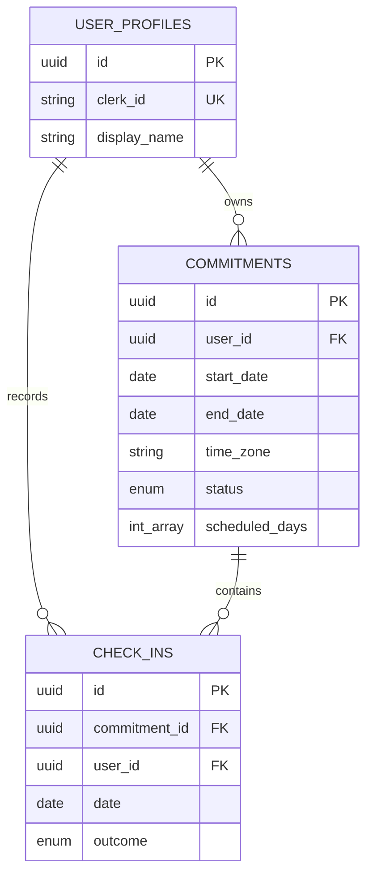

# Database design

PostgreSQL is the selected relational store. Prisma schema: `backend/lockin-api/prisma/schema.prisma`; initial migration: `prisma/migrations/20261018000000_init`.

## Constraints and indexes

- `user_profiles.clerk_id` is unique, making provisioning idempotent.
- `check_ins(commitment_id, date)` is unique, preventing duplicate daily logs even with concurrent requests.
- Deleting a commitment deletes its check-ins; deleting a profile deletes all owned data.
- Commitment list queries use `(user_id, status, created_at)` and `(user_id, end_date)` indexes.
- `check_ins(user_id, date)` supports user-scoped history queries.

The API performs rule-shape validation (frequency, targets, windows, and scheduled-day consistency) before creating records. PostgreSQL constraints preserve relational integrity; lifecycle policy is enforced in the service layer.
